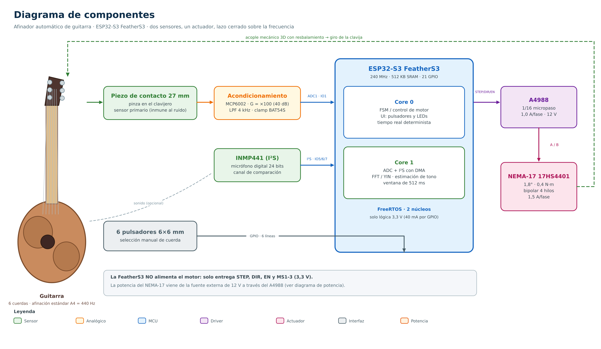
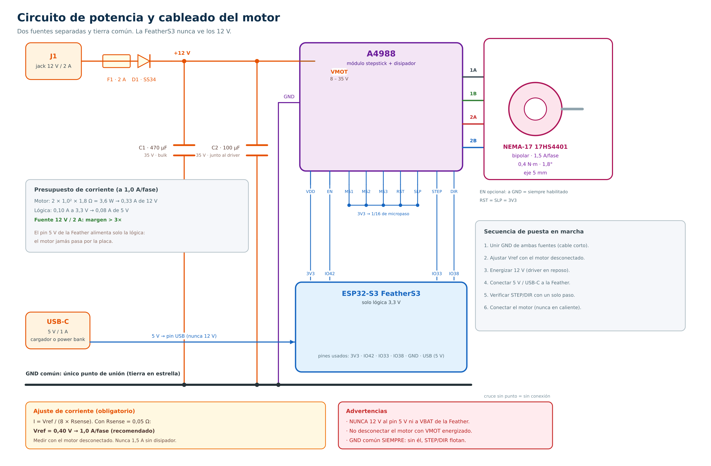
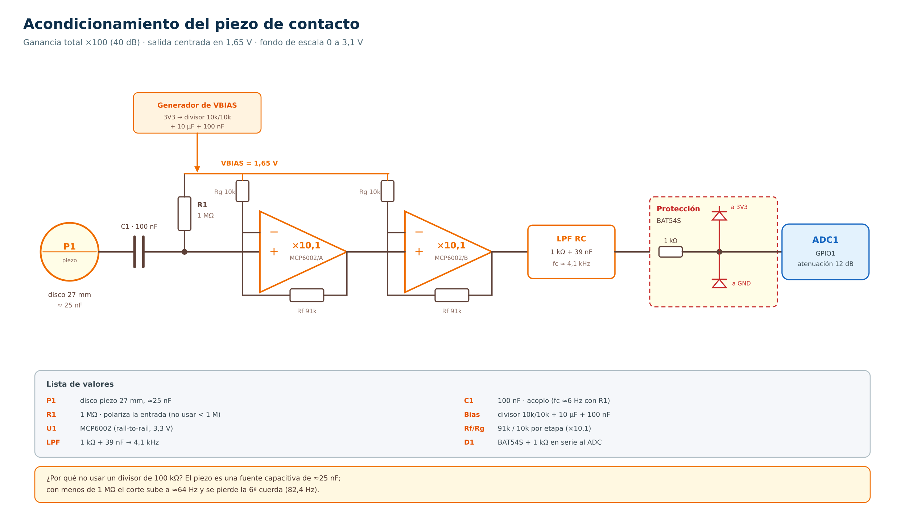
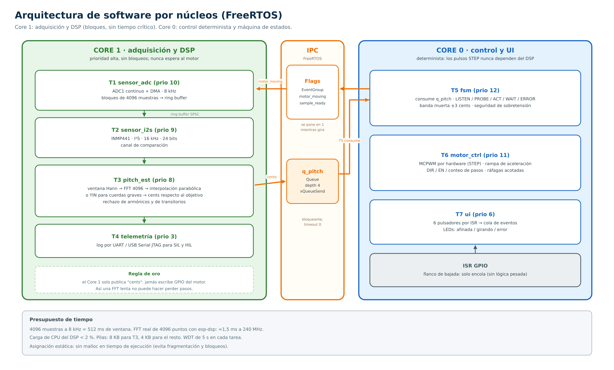
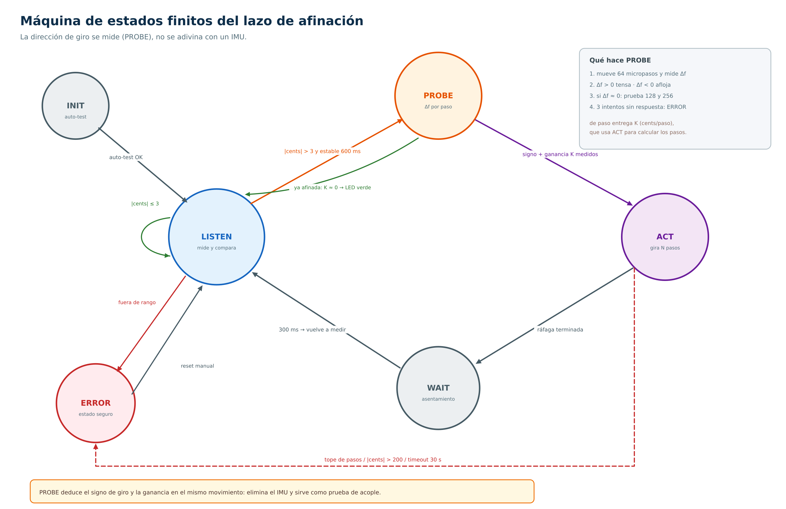

# Anteproyecto — versión 2 (revisada)

## Programación de Sistemas Embebidos

**Título del Proyecto:** Afinador de guitarra automático
**Integrantes:**
**Grupo 6:**

- Felipe Cubillos / 21.461.391-3 / felipe.cubillos.a@usach.cl
- Diego Gómez / 21.389.976-7 / diego.gomez.g@usach.cl
- Tomás Cárcamo / 21.480.741-6 / tomas.carcamo.g@usach.cl

> **Nota de versión.** Este documento reemplaza al anteproyecto original. Se mantiene la
> estructura, el alcance y los objetivos; se corrigen las incoherencias entre la arquitectura,
> el listado de materiales y la estrategia de pruebas, y se incorporan las observaciones del
> profesor. Todos los cambios están trazados en la [sección 6](#6-cambios-respecto-a-la-versión-1).
> Los diagramas son editables y se regeneran con un script incluido en `docs/images/`.

---

# 1. Resumen y Alcance

**Afinador automático de guitarra.**
Sea para una persona que está empezando la guitarra o para alguien que no tiene la habilidad o confianza de afinar por oído, existe nuestra opción la cual utilizando procesamiento de señales sería capaz de leer los datos de las vibraciones y mover las clavijas de manera precisa que quede afinada con la única necesidad de acercar el dispositivo hacia la clavija deseada.

Tomando inspiración de dispositivos cómo el "Roadie Tuner" \[1\], proponemos una alternativa de menor costo y de código abierto. El funcionamiento tiene dos partes:

- **Sistema de detección de notas:** El micrófono sería puesto en cualquier lugar de la guitarra para captar vibraciones minimizando el ruido externo, luego sería procesado y al encontrar la frecuencia fundamental se infiere o se selecciona de forma manual la nota a ser afinada siguiendo el esquema de afinación estándar (A = 440 Hz)
- **Motor de afinación automático:** Se debe de acomodar el motor en la clavija deseada, una vez se detecte la nota el motor se moverá con precisión e internamente hará la comparación de frecuencia objetivo y frecuencia real para aplicar la rotación necesaria para llegar a la cuerda afinada.

**Alcance del prototipo (TRL3).** Se construye una prueba de concepto funcional sobre protoboard y mecánica impresa en 3D: dos sensores (piezo de contacto + micrófono I²S), un actuador (NEMA-17 con driver A4988) y el ESP32-S3 operando en FreeRTOS con dos tareas concurrentes y una máquina de estados. **No** se desarrolla producto, carcasa definitiva ni calibración industrial.

## 1.1 Entregas Incrementales

1. **EV1**: Anteproyecto y Hello World (demostración de FFT)
2. **EV2**: Diseño y Lectura de Datos (pruebas del micrófono y del piezo)
3. **EV3**: Refinar el diseño e implementar la arquitectura de software en FreeRTOS
4. **EV4**: Profundizar en la estrategia de pruebas propuestas (SIL & HIL Testing)
5. **EV5**: Evaluación del proyecto y prototipo en TRL3 (Proof Of Concept)

---

# 2. Arquitectura del Sistema

## 2.1 Diagrama de componentes



*Figura 1 — Diagrama de componentes. El lazo se cierra sobre la frecuencia: el piezo mide, el
ESP32-S3 decide y el A4988 mueve el NEMA-17 sobre la clavija.*

El sistema se organiza en cinco bloques:

| Bloque | Función | Implementación |
|---|---|---|
| **Sensado** | Captura de la vibración de la cuerda | Piezo de contacto 27 mm (primario) + INMP441 I²S (comparación) |
| **Acondicionamiento** | Adaptar la señal del piezo al ADC | MCP6002, ganancia ×100, LPF 4 kHz, clamp BAT54S |
| **Procesamiento** | Estimar la frecuencia fundamental y decidir | ESP32-S3 FeatherS3, FreeRTOS, dos núcleos |
| **Actuación** | Girar la clavija con precisión | A4988 (1/16 micropaso) + NEMA-17 17HS4401 |
| **Energía** | Alimentar lógica y motor por separado | Fuente 12 V/2 A (motor) + 5 V USB-C (lógica) |

## 2.2 Listado de componentes

- **ESP32-S3 FeatherS3 (Unexpected Maker)**: microcontrolador utilizado para la lógica
  computacional, manejo de tareas, procesamiento de señales y control del motor. Doble núcleo
  Xtensa LX7 a 240 MHz, 512 KB de SRAM, instrucciones vectoriales para DSP, 16 MB de flash y
  8 MB de PSRAM, 21 GPIO y dos reguladores LDO de 3,3 V / 700 mA.
- **Micrófono de contacto piezoeléctrico**: captura de las vibraciones de la cuerda. Disco de
  27 mm sobre una pinza en el clavijero; es el sensor primario porque es inmune al ruido
  ambiental (a diferencia de un micrófono de aire).
- **Micrófono omnidireccional INMP441**: sensor digital I²S de 24 bits. Se conserva como **canal
  de comparación** para la caracterización de la EV2 (ver observación del profesor en §6.2).
- **Circuito de acondicionamiento del piezo**: buffer de alta impedancia + dos etapas de
  ganancia + filtro anti-alias + protección del ADC. Detalle en §2.5.
- **Motor paso a paso NEMA-17 (17HS4401)**: actuador de precisión. Bipolar de 4 hilos,
  1,5 A/fase, 1,8°/paso, 0,4 N·m, eje de 5 mm.
- **Driver A4988**: puente H doble con control de corriente por *chopping*. Traduce la lógica de
  3,3 V del ESP32 a la conmutación de las bobinas a 12 V. La corriente se fija por tensión de
  referencia (Vref), no por el voltaje de alimentación.
- **Pulsadores**: seis interruptores táctiles 6×6 mm para selección manual de la cuerda.
- **Acople mecánico impreso en 3D**: boquilla que adapta el eje de 5 mm a la clavija, con
  **resbalamiento calibrado** (O-ring) como límite físico de torque.
- **Pinza para micrófono**: sostiene el piezo en el clavijero.

## 2.3 ¿Cómo interactúa el usuario con el sistema?

De manera obligatoria, el usuario debe acomodar la pinza montada con el micrófono piezoeléctrico en el clavijero de la guitarra de manera que pueda recoger las vibraciones.
Luego, tiene dos opciones para afinar, insertando la boquilla conectada al motor para hacer girar la clavija:

- Ir clavija por clavija, desde la más grave hasta la más aguda sin intervención manual, el mismo microcontrolador va a ir infiriendo cual es la frecuencia más cercana correspondiente y mover el motor acorde.
- Presionar uno de los 6 botones para elegir manualmente cuál es la frecuencia objetivo, luego el motor solamente moverá la clavija hasta que se llegue a la frecuencia deseada.

En ambos modos el dispositivo **no necesita saber cómo está montado**: al primer movimiento
mide si la afinación sube o baja y deduce por sí mismo el sentido de giro (§2.8, estado `PROBE`).

## 2.4 Arquitectura de energía



*Figura 2 — Dos fuentes separadas, tierra común. La FeatherS3 nunca recibe 12 V.*

**Decisión de diseño: dos fuentes.** Para un TRL3 no se justifica diseñar una etapa de
conversión; se usa una fuente de 12 V/2 A para el driver y la alimentación USB-C (cargador o
power bank) para la placa. Esto elimina un convertidor *buck*, reduce el ruido conmutado cerca
del piezo y simplifica la puesta en marcha.

**Regla que no se puede violar: las tierras deben estar unidas.** Un voltaje es una diferencia
entre dos puntos; si el driver no comparte la referencia de GND con la FeatherS3, sus "3,3 V"
no significan nada para él y los pulsos STEP/DIR quedan flotantes (pasos aleatorios). Se separan
las potencias, se une la tierra en un solo punto (estrella) en el negativo del condensador de
entrada.

| Elemento | Valor / tipo | Función |
|---|---|---|
| J1 | Jack 12 V / 2 A | Entrada de potencia del motor |
| F1 | Fusible 2 A | Protección de sobrecorriente |
| D1 | SS34 (Schottky) | Protección de polaridad inversa |
| C1 | 470 µF / 35 V | *Bulk* de entrada (inductancia del cable) |
| C2 | 100 µF / 35 V | Exigido por el datasheet del A4988, a <1 cm de VMOT |
| C3, C4 | 100 nF | Desacoplo de alta frecuencia (no dibujados) |
| USB-C | 5 V / 1 A | Alimentación de la lógica |

**Ajuste de corriente (obligatorio antes de energizar el motor).** La corriente de fase se fija
con el potenciómetro del módulo:

$$I_{fase} = \frac{V_{ref}}{8 \cdot R_{sense}}$$

Con `Rsense = 0,05 Ω` (valor típico de los módulos stepstick):

| Corriente de fase | Vref | Observación |
|---|---|---|
| 0,8 A | 0,32 V | Mínimo útil para afinar |
| **1,0 A** | **0,40 V** | **Recomendado** (≈0,25–0,3 N·m, sin disipador grande) |
| 1,2 A | 0,48 V | Requiere disipador |
| 1,5 A | 0,60 V | Máximo nominal del motor; obligatorio disipador + ventilación |

No se usan los 1,5 A nominales: afinar requiere menos de 0,2 N·m y bajar la corriente reduce
calor, ruido audible y vibración acoplada al piezo.

**Presupuesto de corriente.** Con 1,0 A/fase: motor = 2 × 1,0² × 1,8 Ω = **3,6 W** → 0,33 A de
12 V. Lógica = 0,10 A a 3,3 V → 0,08 A de 5 V. Una fuente de 2 A deja un margen mayor a 3×.

**Advertencias de conexión**

1. Nunca conectar 12 V al pin **5 V** (USB) ni a **VBAT** de la FeatherS3: la entrada máxima de
   sus reguladores es 5,5 V y VBAT es la entrada de un cargador de LiPo de una celda.
2. Nunca desconectar el motor con VMOT energizado (el pico inductivo destruye el driver).
3. GND común siempre, antes de energizar cualquier señal.
4. El motor nunca se alimenta a través de la placa: los 1,5 A no pasan por la Feather ni por la
   protoboard (los contactos de protoboard son de ~1 A). Usar borneras.

## 2.5 Acondicionamiento del piezo



*Figura 3 — Cadena analógica: alta impedancia de entrada, ganancia ×100, filtro y protección.*

El piezo es una **fuente capacitiva** (≈25 nF) de alta impedancia, no una fuente de tensión: si
se carga con una resistencia baja, se forma un filtro pasa-altos que recorta las cuerdas graves.
Con `R1 = 1 MΩ` el corte queda en `fc = 1/(2π·1M·25n) ≈ 6 Hz`, muy por debajo de la 6ª cuerda
(82,4 Hz). Con 100 kΩ el corte subiría a ≈64 Hz y se perdería el Mi grave. Por eso:

- **R1 ≥ 1 MΩ** (idealmente 4,7–10 MΩ con un JFET, fuera del alcance del prototipo).
- **Dos etapas no inversoras** de ×10,1 (Rf = 91 kΩ, Rg = 10 kΩ), referidas a VBIAS y no a GND,
  para que la salida quede centrada en 1,65 V con alimentación simple de 3,3 V.
- **LPF RC de 4,1 kHz** (1 kΩ + 39 nF) como anti-alias para `fs = 8 kHz`.
- **Clamp BAT54S + 1 kΩ en serie al ADC**: un disco golpeado genera decenas de volts y
  destruiría el pin. Los diodos recortan a 3V3 + Vf y a −Vf.
- **ADC1 (GPIO1)** con atenuación de 12 dB (fondo de escala 0–3,1 V). Se usa ADC1 porque ADC2
  tiene restricciones cuando el radio está activo.

Ganancia total ≈ ×100 (40 dB): con una vibración de 5–20 mV en el piezo se aprovecha buena parte
del fondo de escala del ADC.

## 2.6 Mapa de pines

| Función | GPIO (FeatherS3) | Nota |
|---|---|---|
| Piezo → ADC | **IO1** | ADC1_CH0. ADC1 = GPIO1–10; no usar ADC2 |
| I²S INMP441 — BCLK | IO5 | |
| I²S INMP441 — WS (LRCLK) | IO6 | |
| I²S INMP441 — SD (DIN) | IO7 | L/R del módulo a GND (canal izquierdo) |
| STEP | IO33 | Generado por MCPWM (hardware) |
| DIR | IO38 | |
| EN | IO42 | Opcional: a GND = driver siempre habilitado |
| MS1 / MS2 / MS3 | 3V3 | Cableados a 3,3 V → 1/16 de micropaso |
| RST / SLP | 3V3 | Puenteados entre sí y a 3,3 V |
| Botón 1…6 | IO4, IO10, IO11, IO12, IO14, IO17 | Pull-up interno + 100 nF de debounce |
| LED de estado | IO13 / NeoPixel IO40 | IO39 habilita la alimentación del NeoPixel |
| I²C (reserva: OLED) | IO8 / IO9 | STEMMA QT horizontal |

**Pines a evitar:** IO0 (BOOT), IO19/IO20 (USB D−/D+), IO2 e IO34 (sensado de VBAT/VBUS),
IO39 (habilitación de LDO2), IO41 (switch de antena), IO43/IO44 (UART0), IO45/IO46 (strapping).

## 2.7 Arquitectura de software por núcleos



*Figura 4 — Reparto de tareas entre núcleos y mecanismos de comunicación.*

El criterio de reparto es **aislar el tiempo real del procesamiento pesado**: una FFT lenta
nunca debe poder hacer perder pasos del motor.

| Núcleo | Tarea | Prioridad | Función |
|---|---|---|---|
| 1 | `sensor_adc` | 10 | ADC1 continuo con DMA, 8 kHz, bloques de 4096 muestras |
| 1 | `sensor_i2s` | 9 | INMP441 por I²S, 16 kHz, 24 bits |
| 1 | `pitch_est` | 8 | Ventana Hann → FFT 4096 → interpolación parabólica; YIN para cuerdas graves |
| 1 | `telemetria` | 3 | Log por UART para SIL/HIL |
| 0 | `fsm` | 12 | Máquina de estados, banda muerta, seguridad |
| 0 | `motor_ctrl` | 11 | MCPWM, rampa de aceleración, conteo de pasos |
| 0 | `ui` | 6 | Pulsadores (ISR + cola), LEDs |

**Comunicación:** cola `q_pitch` (profundidad 4) del núcleo 1 al núcleo 0; `EventGroup` con las
banderas `motor_moving` (silencia la adquisición mientras gira) y `sample_ready`. El *ring
buffer* de muestras es de un solo productor y un solo consumidor, con asignación estática: no se
usa `malloc` en tiempo de ejecución.

**Presupuesto de tiempo:** 4096 muestras a 8 kHz = 512 ms de ventana; una FFT real de 4096
puntos con `esp-dsp` tarda ≈1,5 ms a 240 MHz, es decir menos del 2 % de CPU.

## 2.8 Máquina de estados finitos



*Figura 5 — FSM. La dirección de giro se mide en `PROBE`, no se deduce de un sensor de
orientación.*

| Estado | Acción | Salida |
|---|---|---|
| `INIT` | Autotest de periféricos y del driver | → `LISTEN` |
| `LISTEN` | Adquiere y estima la frecuencia; calcula el error en cents | `PROBE` si \|cents\| > 3; permanece si está afinada |
| `PROBE` | Mueve 64 micropasos y mide Δf | Deduce el signo y la ganancia K (cents/paso) |
| `ACT` | Calcula `N = cents / K` (acotado) y ejecuta la ráfaga | → `WAIT` |
| `WAIT` | Espera 300 ms de asentamiento mecánico | → `LISTEN` |
| `ERROR` | Bloquea el motor y señaliza | Reset manual |

**Por qué `PROBE` y no un IMU.** Tensar una cuerda siempre sube la afinación: el signo de giro no
depende de la guitarra sino de cómo quedó montada la herramienta. Un IMU *infiere* ese montaje a
partir de la orientación; `PROBE` lo **mide**, y de paso entrega la ganancia K que el lazo
necesita para calcular cuántos pasos dar. Además detecta el fallo más peligroso: si Δf ≈ 0 tras
tres intentos, la herramienta no está enganchada en la clavija.

**Banda muerta de ±3 cents** (no ±0,5 Hz como en la v1): un margen fijo en hercios equivale a
10 cents en el Mi grave y a 2,6 cents en el Mi agudo, por lo que no es un criterio uniforme.

**Condiciones de error:** frecuencia fuera de 60–1200 Hz, Δf nulo tras tres sondeos, |cents| >
200, tope de pasos acumulados o tiempo de lazo mayor a 30 s.

## 2.9 Estrategia de pruebas

Inicialmente, se va a usar una estrategia de software in the loop (SIL) que consiste en lo siguiente:

**Para la sección de recolección de señales.** Estas pruebas validan la precisión matemática de la FFT y la lógica de temporización sin requerir el hardware ESP32 ni un instrumento físico. En un framework de pruebas mediante PlatformIO, se alimentarían arreglos estáticos en C a las funciones para simular el búfer del ADC.

- **Verificación de onda senoidal pura**: Pasar un arreglo que representa una onda senoidal de 440 Hz a la función FFT. Verificar que la función devuelva 440,0 Hz ± 0,5 cents, confirmando que el algoritmo central funciona.
- **Rechazo de armónicos**: Pasar un arreglo compuesto que contenga una onda fundamental de 82,41 Hz (Mi grave) mezclada con sus armónicos segundo y tercero (164,8 Hz y 247,2 Hz) con amplitudes mayores. Verificar que la lógica de detección de picos devuelva correctamente la fundamental de 82,41 Hz.
- **Rechazo de ruido transitorio**: Alimentar el búfer simulado con 50 ms de ruido aleatorio de alta amplitud seguidos de ceros constantes. Verificar que el temporizador de software se reinicie, que la tarea rechace la entrada como un "golpe" accidental y que no se envíen datos a la cola.
- **Validación de sostenido**: Introducir una onda simulada continua de 600 ms en el búfer. Verificar que se cumpla la condición de "pulsación sostenida" y que los datos se envíen a la cola entre núcleos.
- **Resolución del estimador** *(nueva)*: con la misma senoidal, verificar que el error de estimación sea < 3 cents en las seis cuerdas, incluyendo el Mi grave (el caso más exigente: un bin de FFT a 8 kHz/4096 equivale a 41 cents, por lo que la interpolación es obligatoria).

**Para la sección de actuación del motor.** Validar que el bucle de control calcula las respuestas mecánicas correctas según los datos de frecuencia que recibe.

- **Lógica direccional por sonda** *(reemplaza la prueba del IMU)*: simular la cola con Δf = +8 cents tras el sondeo de 64 pasos y verificar que la FSM registre "tensar" y actualice K; simular Δf = −8 cents y verificar "aflojar".
- **Falta de acople**: simular Δf ≈ 0 en los tres sondeos (64, 128 y 256 pasos) y verificar que la FSM transicione a `ERROR` sin ejecutar `ACT`.
- **Adquisición y detención del objetivo**: simular la cola con exactamente 440,0 Hz (dentro de ±3 cents) y verificar que la FSM permanezca en `LISTEN` y que el contador de pasos sea 0.
- **Seguridad contra sobretensión**: simular un valor atípico (600 Hz o |cents| > 200). Verificar que la FSM dispare `ERROR`, se niegue a calcular pasos y requiera reinicio manual.
- **Saturación del cálculo**: verificar que `N = cents / K` se acote al máximo de pasos por ráfaga y que se respete el tope acumulado.

---

# 3. Especificaciones Técnicas

- **Procesador seleccionado:**
  - **Marca y modelo:** Espressif Systems ESP32-S3, en placa **Unexpected Maker FeatherS3**.
  - **Principales características:** doble núcleo Xtensa LX7 de 32 bits hasta 240 MHz, instrucciones vectoriales que aceleran el DSP (FFT), 512 KB de SRAM, pines ADC con lectura continua por DMA, dos reguladores de 3,3 V / 700 mA (el segundo controlable por IO39), USB-C con protección de *back-feed*, cargador de LiPo de una celda y 21 GPIO.
  - **Referencia Técnica:** [ESP32-S3 Series Datasheet (Espressif)](https://www.espressif.com/sites/default/files/documentation/esp32-s3_datasheet_en.pdf)

- **Sensores y Entradas:**
  - **Sensor piezoeléctrico de contacto**
    - **Tipo y modelo:** disco piezoeléctrico genérico de 27 mm (tipo Murata 7BB).
    - **Magnitud:** vibración mecánica del clavijero; genera carga eléctrica proporcional a la deformación.
    - **Protocolo:** lectura analógica por ADC1 con DMA, `fs = 8 kHz`.
    - **Referencia:** [Piezoelectric Sound Components Application Manual (Murata)](https://www.murata.com/~/media/webrenewal/support/library/catalog/products/sound/p15e.ashx)
  - **Micrófono omnidireccional INMP441**
    - **Tipo y modelo:** MEMS digital omnidireccional, 24 bits, 60 Hz–15 kHz.
    - **Protocolo:** **I²S** (BCLK, WS, SD), no I²C. El ESP32-S3 actúa como maestro; L/R a GND.
    - **Referencia:** [Información del Chip (DigiKey)](https://www.digikey.com.mx/es/product-highlight/i/invensense/inmp441-mems-digital-microphone)
  - **Pulsador momentáneo**
    - **Tipo y modelo:** interruptor táctil 6×6 mm normalmente abierto (tipo Omron B3F).
    - **Magnitud:** estado binario; se lee con pull-up interno e interrupción por flanco de bajada.
    - **Referencia:** [B3F Tactile Switch Datasheet (Omron)](https://omronfs.omron.com/en_US/ecb/products/pdf/en-b3f.pdf)

- **Actuador:**
  - **Motor paso a paso NEMA-17 (17HS4401)**
    - Bipolar de 4 hilos, 1,5 A/fase, 1,8 Ω/fase, ≈3,2 mH, 1,8°/paso, 0,4 N·m, eje 5 mm.
    - **Referencia:** [17HS4401 Specifications (Handson Tech)](https://www.handsontec.com/dataspecs/17HS4401S.pdf)
  - **Driver A4988**
    - VMOT 8–35 V; VDD 3,0–5,5 V (compatible con lógica de 3,3 V, sin *level shifter*);
      2 A de pico / 1 A continuo sin disipador; micropaso máximo 1/16; `Rsense = 0,05 Ω`.
    - **Referencia:** [A4988 Datasheet (Allegro)](https://www.allegromicro.com/~/media/Files/Datasheets/A4988-Datasheet.ashx)

## 3.1 Resolución del lazo (cálculo de diseño)

El paso del motor no se traduce en un cambio fijo de afinación: depende del diámetro del poste y
del calibre de la cuerda. Con un poste de radio efectivo ≈3,3 mm, una reducción 18:1 en el
clavijero y 1/16 de micropaso (3200 pasos/vuelta), el modelo `Δf/f = ½·ΔT/T` con
`ΔT = E·A·ΔL/L` entrega:

| Cuerda | Frecuencia | cents por micropaso | 64 pasos |
|---|---|---|---|
| E2 (6ª) | 82,41 Hz | ≈1,0 | ≈64 cents |
| A2 (5ª) | 110,00 Hz | ≈0,6 | ≈38 cents |
| D3 (4ª) | 146,83 Hz | ≈0,34 | ≈22 cents |
| G3 (3ª) | 196,00 Hz | ≈0,19 | ≈12 cents |
| B3 (2ª) | 246,94 Hz | ≈0,12 | ≈8 cents |
| E4 (1ª) | 329,63 Hz | ≈0,07 | ≈4,5 cents |

Dos consecuencias directas:

1. **La sensibilidad varía ≈14:1 entre la 6ª y la 1ª cuerda**, por lo que la sonda debe ser
   adaptativa (64 → 128 → 256 micropasos) y nunca de amplitud fija.
2. **El juego mecánico del clavijero (backlash) puede superar el movimiento útil** de un sondeo.
   Por eso `PROBE` hace una **precarga** de ~40 pasos en el mismo sentido antes de medir.

Estos valores son estimaciones analíticas y se validan en HIL durante la EV4; el sistema los
reaprende en cada sondeo (ganancia K).

## 3.2 Resolución del estimador de frecuencia

Con `fs = 8 kHz` y 4096 muestras, el bin de FFT es de 1,95 Hz: 41 cents en el Mi grave y 10
cents en el Mi agudo. Por lo tanto **no alcanza con buscar el pico**:

- **FFT + interpolación parabólica** sobre la magnitud en dB: error típico 0,01–0,05 bin →
  ≈1–3 cents en las cuerdas medias y agudas.
- **YIN / autocorrelación** para E2 y A2: exactitud sub-muestra → ≈1 cent.

La banda muerta de ±3 cents se elige por encima del ruido del estimador (≈2σ) y por debajo del
umbral audible de desafinación.

---

# 4. Lista de Materiales

*Tabla 1 — Lista de materiales (precios referenciales en CLP, octubre 2026).*

| # | Componente | Cant. | Tipo | Proveedor / Enlace | Precio |
|---|---|---|---|---|---|
| 1 | ESP32-S3 FeatherS3 (Unexpected Maker) | 1 | MCU | Aportado por el grupo | $0 |
| 2 | Motor paso a paso NEMA-17 17HS4401 (1,5 A) | 1 | Actuador | [Afel](https://afel.cl/products/motor-paso-a-paso-nema-17-modelo-17hs4401-1-5-a) | $12.000 |
| 3 | Driver Pololu A4988 + disipador | 1 | Driver | [Afel](https://afel.cl/products/controlador-de-motores-paso-a-paso-driver-pololu-a4988) | $2.000 |
| 4 | Micrófono INMP441 I²S (1 + 1 repuesto) | 2 | Sensor | [Afel](https://afel.cl/products/sensor-microfono-omnidireccional-inmp441) | $11.980 |
| 5 | Sensor piezoeléctrico 27 mm con cable | 2 | Sensor | [Mechatronic Store](https://www.mechatronicstore.cl/sensor-piezoelectrico-27mm-con-cable/) | $1.980 |
| 6 | MCP6002 + kit de resistencias y capacitores | 1 | Acondicionamiento | MCI Electronics | $2.500 |
| 7 | Protección y filtrado: fusible 2 A + portafusible, SS34, 470 µF/35 V, 100 µF/35 V, 100 nF ×5 | 1 | Energía | MCI Electronics | $2.000 |
| 8 | Borneras 2 y 4 pines + cable | 1 | Energía | MCI Electronics | $1.500 |
| 9 | Pulsadores 6×6 mm (×6), LEDs y resistencias | 1 | Interfaz | MCI Electronics | $1.500 |
| 10 | Fuente de alimentación 12 V / 2 A con jack | 1 | Energía | Afel / MCI | $5.000 |
| 11 | Cable USB-C de datos y alimentación | 1 | Energía | MCI | $2.000 |
| 12 | Mecánica: filamento, tornillos M3, acoplador 5 mm, O-ring | 1 | Mecánica | Impresión 3D | $4.500 |
| | **Total** | | | | **$46.960** |

**Notas de la BOM**

- El ítem 1 figura en $0 por ser aportado por el grupo (valor de referencia ≈$25.000). La v1
  listaba un "Devkit V1 de 30 pines" que no corresponde al hardware del proyecto.
- Se compran **dos** INMP441 porque el componente está marcado *NRND* (no recomendado para
  diseños nuevos) y no tiene reemplazo pin a pin.
- No se incluye convertidor *buck* 12→5 V: la arquitectura de dos fuentes lo hace innecesario
  (ahorro ≈$2.000 y una fuente de ruido menos).
- No se incluye IMU: la dirección de giro se resuelve por software (§2.8).

---

# 5. Análisis de Riesgos

| # | Riesgo | Prob. | Impacto | Mitigación |
|---|---|---|---|---|
| 1 | El ruido mecánico del motor interfiere con la lectura del piezo, introduciendo falsas frecuencias | Alta | Medio | Bandera `motor_moving` que descarta las muestras durante el giro; montaje con amortiguación (TPU); separación de tierras analógica y de potencia; apagado del driver (EN) entre movimientos |
| 2 | El motor ejerce demasiada tensión y corta la cuerda | Media | **Alto** | Acople con resbalamiento calibrado (O-ring) como límite físico; tope de pasos por ráfaga; estado `ERROR` si \|cents\| > 200; sonda adaptativa |
| 3 | El NEMA-17 requiere 12 V y la placa opera a 3,3 V; riesgo de quemar la FeatherS3 | Media | **Alto** | Dos fuentes separadas y **GND común**; la placa solo recibe 5 V por USB-C; el driver solo ve lógica de 3,3 V; protecciones en la entrada de 12 V |
| 4 | Sobrecarga del procesador por el cálculo de la FFT, perdiendo pasos del motor | Media | Alto | Núcleos separados: adquisición/DSP en el núcleo 1 y control determinista en el núcleo 0; STEP generado por MCPWM de hardware |
| 5 | Deslizamiento físico entre el eje del motor y la clavija al aplicar torque | Alta | Medio | Acople rígido impreso a medida + acoplador flexible; verificación por sonda (Δf nulo = sin acople) |
| 6 | Juego mecánico (backlash) del clavijero: el motor gira sin mover la cuerda | **Alta** | Medio | Precarga de ~40 pasos en el mismo sentido antes de medir; siempre aproximar desde la misma dirección |
| 7 | Resolución insuficiente del estimador en las cuerdas graves | Media | Medio | Interpolación parabólica / YIN; ventana de 512 ms; validación SIL con tolerancia de 3 cents |
| 8 | Falla el INMP441 y no hay reemplazo pin a pin (NRND) | Media | Bajo | Se compra una unidad de repuesto; el sensor primario es el piezo |

---

# 6. Cambios respecto a la versión 1

## 6.1 Tabla de trazabilidad

| Ítem | Versión 1 | Versión 2 | Motivo |
|---|---|---|---|
| MCU en la BOM | "ESP32 Devkit V1 30 pines MicroUSB" | FeatherS3 (ESP32-S3) | La BOM no coincidía con la especificación técnica ni con el hardware disponible |
| INMP441 en el diagrama | I²C | **I²S** | Error de protocolo: el INMP441 es un micrófono digital I²S |
| Dirección de giro | Sensor IMU (MPU6050) simulado en las pruebas | Estado **`PROBE`** | El IMU no estaba en la BOM ni en el diagrama, y no conoce el acople mecánico |
| Alimentación | "Fuente 12 V/2 A" sin detalle | Diagrama de potencia + dos fuentes + GND común + Vref | Faltaba el conexionado completo y el ajuste de corriente |
| Acondicionamiento del piezo | Caja negra "acondicionamiento eléctrico" | Circuito con valores (MCP6002, R1 = 1 MΩ, LPF, clamp) | Observación del profesor sobre la respuesta en frecuencia |
| Banda muerta | ±0,5 Hz | ±3 cents | 0,5 Hz son 10 cents en el Mi grave y 2,6 cents en el Mi agudo |
| BOM | $27.480 sin protección ni mecánica | $46.960 con protección, acondicionamiento y mecánica | Trazabilidad real de costos |
| Micrófono | Dos sensores, rol indefinido | Piezo primario + INMP441 como canal de comparación | Responde la observación del profesor con datos de la EV2 |

## 6.2 Respuesta a las observaciones del profesor

**"Respuesta en frecuencia del piezo".** Un disco de 27 mm tiene su resonancia en torno a
3–4,5 kHz y por debajo de ella su respuesta cae ≈20 dB/década: a 82 Hz se pierden 30–35 dB
respecto del pico. Tres consecuencias de diseño:

1. La impedancia de carga debe ser **≥1 MΩ** para no recortar las cuerdas graves (§2.5).
2. Se necesita **ganancia de 40 dB** para aprovechar el ADC.
3. Conviene un disco de 35 mm si en la EV2 la relación señal/ruido del Mi grave resulta
   insuficiente (resonancia más baja).

En la EV2 se medirá la curva de respuesta real (barrido de 60 Hz a 2 kHz con el piezo montado en
el clavijero) y se adjuntará como evidencia.

**"¿No se necesita un micrófono realmente?".** Para el caso de uso —pinza sobre el clavijero— el
piezo gana porque rechaza el ruido ambiente y capta la vibración directamente. El INMP441 se
mantiene por dos razones: (a) permite cuantificar esa diferencia con mediciones en la EV2, y
(b) asegura el requisito de "al menos dos sensores" con un segundo canal independiente. Si la
comparación muestra que el INMP441 no aporta, se documentará y se retirará del prototipo final.

## 6.3 Decisiones de diseño registradas

| Decisión | Alternativa descartada | Justificación |
|---|---|---|
| Dos fuentes (12 V + USB-C) | Buck 12→5 V desde la misma fuente | Menos piezas, menos ruido conmutado cerca del piezo, suficiente para TRL3 |
| A4988 a 1/16 | A4988 a paso completo | A 1/16 el paso vale ≈0,07 cents (1ª cuerda) a ≈1 cent (6ª); a paso completo serían ≈1 a ≈16 cents: imposible afinar |
| A4988 (vs. TMC2209) | TMC2209 (StealthChop) | El A4988 ya está disponible; el TMC2209 queda como mejora si el ruido del motor degrada la medición |
| Sonda `PROBE` | IMU MPU6050 | El IMU infiere; la sonda mide, y además entrega la ganancia del lazo |
| INMP441 conservado | Un solo sensor (piezo) | Evidencia experimental para la observación del profesor y requisito de dos sensores |

---

# 7. Referencias

1. Roadie Music. *Roadie 3: The Next-Generation Automatic Guitar Tuner*. https://www.roadiemusic.com/roadie3
2. Espressif Systems. *ESP-IDF FreeRTOS (SMP) Documentation*.
3. Allegro MicroSystems. *A4988 Stepper Motor Driver Datasheet*.
4. Espressif Systems. *ESP32-S3 Series Datasheet*.
5. Murata Manufacturing. *Piezoelectric Sound Components Application Manual*.
6. Omron. *B3F Tactile Switch Datasheet*.
7. Handson Technology. *17HS4401 Stepper Motor Specifications*.
8. InvenSense. *INMP441 Omnidirectional Microphone Datasheet*.
9. Unexpected Maker. *FeatherS3 — pinout y esquemático*. https://esp32s3.com/feathers3.html
10. Texas Instruments. *AN-1142 Buck Converter Design* (para la alternativa descartada).

---

# Rúbrica de Aprobación (Completar por el profesor)

- [x] ~~Alcance del proyecto: el proyecto se encuentra bien definido en el contexto del curso, usa al menos dos sensores, un actuador y un CPU.~~
- [x] ~~Alcance del desarrollo de software: el proyecto presenta un desafío adecuado de desarrollo de software, donde se requiere realizar más de una tarea a la vez y atender diferentes eventos.~~
- [x] ~~Arquitectura coherente: La arquitectura de hardware presentada es coherente con el problema planteado~~
- [x] ~~Arquitectura bien documentada: Presenta un diagrama de bloques, de flujo y/o UML coherente y técnicamente correcto.~~
- [ ] Sensores y actuadores: La lista de sensores y actuadores es coherente con el problema y la plataforma de hardware disponible. No presentan dificultades mayores para su uso.
- [x] ~~Lista de materiales clara y adquirible: Proveedores locales o de despacho rápido dentro del plazo. El presupuesto es el adecuado.~~
- [x] ~~Presenta al menos 5 riesgos relevantes para el proyecto y entiende cómo manejarlos.~~

## Estado del Anteproyecto

- [ ] Aprobado con observaciones menores
- [ ] Aprobado con cambios menores
- [ ] Reformular con observaciones mayores

Observaciones:

- Respuesta en frecuencia del piezoeléctrico → **respondida en §6.2** (curva a medir en EV2).
- ¿No se necesita un micrófono realmente? → **respondida en §6.2** (se conserva como canal de
  comparación).

---

# Anexo A — Diagramas y cómo regenerarlos

Los diagramas son archivos SVG con una versión PNG para visualización. El script
`docs/images/generar_diagramas.py` los reconstruye a partir de sus definiciones:

```bash
cd docs/images
python3 generar_diagramas.py      # requiere rsvg-convert
```

| Archivo | Contenido | Figura |
|---|---|---|
| `diagrama-componentes.svg` | Bloques del sistema y flujo de señales | Figura 1 |
| `circuito-potencia.svg` | Alimentación, driver, motor y tierra común | Figura 2 |
| `circuito-piezo.svg` | Cadena de acondicionamiento analógico | Figura 3 |
| `arquitectura-software.svg` | Tareas de FreeRTOS por núcleo e IPC | Figura 4 |
| `maquina-estados.svg` | FSM del lazo de afinación | Figura 5 |

# Anexo B — Hitos de validación

| Entrega | Entregable verificable | Criterio de aceptación |
|---|---|---|
| EV1 | FFT sobre señal sintética | 440 Hz ± 0,5 cents en SIL |
| EV2 | Curva de respuesta del piezo y comparación con el INMP441 | SNR suficiente en E2 y E4; informe con ambas curvas |
| EV3 | FreeRTOS con dos núcleos y FSM completa | Sin bloqueos ni *watchdog* en 30 min de operación |
| EV4 | Suite SIL + HIL | Cobertura de todos los estados y de las condiciones de error |
| EV5 | Prototipo TRL3 | Afina las seis cuerdas en < 30 s desde ±50 cents |
